# 김동욱

Python · LLM · 모델 학습

Sonnet이 쓰던 글을 8B 모델이 대신 쓰게 학습시키고 있다.

카카오테크 부트캠프 4기 AI 과정 
2026.05 ~ 진행 중

<picture>
  <source media="(prefers-color-scheme: dark)" srcset="https://raw.githubusercontent.com/KIMDONGWOOK12/KIMDONGWOOK12/main/dist/defense-dark.svg">
  
</picture>

## Tech Stack

서비스

    

LLM

    

모델 학습 · 서빙

   

## 팀 프로젝트

### [KGB, Korean-culture Guide Book](https://kguidebook.site/about)

`2026.08 ~ 진행 중` `6인 팀 · AI 담당`

AI 여행 가이드북 서비스. AI 팀 두 명 중 한 명이고, 장소 추천과 가이드북 글을 맡았다. 글은 처음에 Sonnet으로 썼는데 비용도 들고 응답도 느려서, 같은 글을 쓰는 모델을 직접 학습하기로 했다.

kanana-1.5-8b를 bf16 LoRA로 일곱 번 학습했다. TRL은 안 쓰고 transformers Trainer와 peft로 SFT를 짰다. 데이터는 train 2,206건에 test 200건. 학습 전 22%였던 자동 검사 통과율이 v7에서 81%가 됐고, GPT 심판으로 같은 입력을 비교하면 Sonnet 대비 74%에서 84%까지 올라왔다. 가장 크게 바뀐 건 장소 개요를 입력에 넣었을 때다. 글의 구체성 점수가 1.80에서 3.96으로 두 배 넘게 뛰었다.

RunPod L4에서 재 보니 비용은 Sonnet의 7~25%, 첫 토큰까지는 1.94초였다. 모델은 Hugging Face [orbit01/kgb-writer-v7](https://huggingface.co/orbit01/kgb-writer-v7)에, 학습 코드는 [팀 레포](https://github.com/100-hours-a-week/KTB4-10th-AI)에 올려 뒀다.

### [Orbit](https://github.com/KIMDONGWOOK12/Orbit)

4명이 만든 SNS 백엔드. FastAPI로 계층을 나누고 회원가입과 로그인(bcrypt, JWT)을 구현했다.

## 개인 프로젝트

### [job-radar](https://github.com/KIMDONGWOOK12/job-radar)

`2026.11` `Claude Code 플러그인`

취업 준비하면서 채용 사이트를 매일 돌아보는 게 귀찮아서 만들었다. 직무와 연차를 한 번 알려 주면 대기업, 중견, 강소, 공기업 채용 페이지를 돌면서 맞는 공고만 노션 DB에 넣어 준다. 이미 넣은 공고는 건너뛰고, 마감된 공고는 알아서 지운다.

회사는 2026년 공정위 공시대상기업집단 102개를 기준으로 잡아서 지금 115곳 정도를 본다. 그리팅, 마이다스, Greenhouse, 잡알리오, 삼성·CJ·네이버·카카오·토스 채용 사이트에서 공고를 가져오는 MCP 서버는 Python으로 짰고, 공고 본문까지 읽어서 자격 요건의 연차를 확인한다.

## 경력과 활동

- 2026.05 ~ 현재　카카오테크 부트캠프 4기 AI 과정
- 2026.02 ~ 2026.03　디메타(Dimeta) AI 개발팀 인턴. 영상 비전 모델 학습 데이터 라벨링과 정제, Agent AI 리서치 세미나
- 2024 ~ 2025　AI컴퓨터공학과 학회장 (2년)
- AI컴퓨터공학과 전공

<!--
## 연락처
연락처를 공개하고 싶다면 이 주석을 풀고 주소를 채워 넣으세요.
- Email: you@example.com
-->
